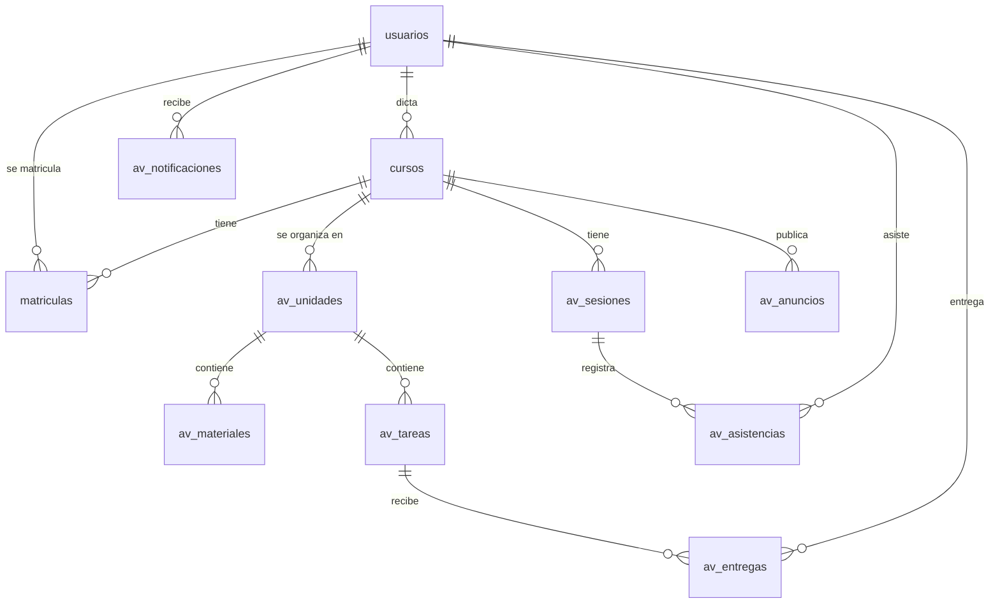

# 04 - Base de datos

Modelo inicial. El script completo está en [`database/schema.sql`](../database/schema.sql).

> Las tablas `usuarios`, `cursos` y `matriculas` pueden venir del Sistema de Gestión existente.
> Aquí se describen para que el aula virtual funcione aunque se instale sola.

## Diagrama entidad-relación

## Tablas

| Tabla | Descripción |
|---|---|
| `usuarios` | Todas las personas del sistema con su rol (admin, direccion, docente, alumno). Alumnos entran con `dni`, docentes con `correo`. `password_hash` vacío = alumno cargado en lista que aún no creó su contraseña. `es_prueba` marca cuentas del antiguo modo prueba (ya no entran) |
| `cursos` | **Módulo** (en pantalla se llama así) por periodo, especialidad, turno y horario; tiene un docente. Lo crea el docente o el admin |
| `matriculas` | Relación alumno–curso |
| `av_unidades` | **Clases** de un módulo, con `fecha_inicio`, `fecha_fin` y `estado` (`auto` = se abre y cierra sola según las fechas; `abierta`/`cerrada` = el docente decide). Clase cerrada: se ven los materiales pero no se entrega |
| `av_materiales` | Archivos, enlaces o videos publicados en una unidad |
| `av_tareas` | Tareas con fecha límite, puntaje y si acepta entregas tardías; `criterios` = qué revisará el docente: una línea por criterio, `texto|puntos` (los puntos son opcionales; si hay, suman 20). Se muestran al alumno |
| `av_entregas` | Entrega del alumno: archivo/enlace, fecha, si fue tardía, nota y comentario |
| `av_sesiones` | Cada clase dictada (fecha) para registrar asistencia |
| `av_asistencias` | Estado de asistencia de cada alumno por sesión |
| `av_anuncios` | Avisos del docente al curso |
| `av_notificaciones` | Notificaciones internas por usuario |
| `av_conversaciones` | Conversación privada entre un alumno y el docente de un curso |
| `av_mensajes` | Mensajes de una conversación (con fecha de lectura); pueden llevar una foto o archivo (`archivo_ruta`, `archivo_nombre`) |
| `av_cuestionarios` | Formularios (examen, trabajo o encuesta): fecha límite, tiempo, intentos, mezclar, mostrar respuestas, mensaje final, publicado |
| `av_preguntas` | Preguntas: 13 tipos (como Google Forms), obligatoria, descripción, imagen, puntos, respuesta correcta, explicación, escala |
| `av_opciones` | Opciones de una pregunta y cuál(es) es correcta; en cuadrículas, sus filas y columnas |
| `av_intentos` | Cada vez que un alumno da un examen: puntaje, nota 0–20 y si falta revisar |
| `av_respuestas` | Respuesta del alumno a cada pregunta (opciones, texto o archivo) y puntos obtenidos |
| `av_inscripcion` | Código de cada módulo (ej. `PEL4821`, se muestra PEL-4821), si acepta alumnos nuevos y el enlace del grupo de WhatsApp (`whatsapp_grupo`, opcional) |
| `av_perfiles` | Datos extra de la persona: fecha de nacimiento, cómo se creó la cuenta (`admin`, `lista`, `registro`), cuándo la activó y si debe elegir su contraseña al entrar (`cambiar_clave`) |
| `av_unidades_didacticas` | Unidades didácticas de un módulo (como en el plan de estudios): nombre, créditos y horas, en orden. Es una lista informativa del módulo (`curso_id` → `cursos`); las clases, tareas y notas siguen siendo del módulo completo |
| `av_registro` | Registro de actividad: accesos, cambios de contraseña, cuentas creadas o desactivadas, notas, ajustes y módulos archivados (quién, qué, cuándo, desde qué IP) |
| `av_configuracion` | Ajustes que cambia el admin: nombres, colores, logo, foto de entrada, ayuda, enlaces al reglamento y al horario (`reglamento_url`, `horario_url`), aviso general, registro abierto, especialidades (JSON) |
| `av_accesos` | Intentos fallidos de entrar, de DNI y de códigos (frena a quien prueba contraseñas) |
| `av_evaluacion` | Cómo se calcula la nota final del módulo: % de trabajos, tests y asistencia, y nota para aprobar |
| `av_preguntas_clase` | Preguntas de la clase: los alumnos preguntan y el docente o compañeros responden (`padre_id` = respuesta) |
| `av_migraciones` | Actualizaciones de la base ya aplicadas (las aplica `src/herramientas/migrar.php`) |

**Papelera:** `av_tareas`, `av_cuestionarios` y `av_materiales` tienen `eliminado_at`. Borrar solo pone la fecha;
todas las consultas ignoran lo que tiene fecha. A los 30 días se borra de verdad (al abrir la papelera o al
correr el respaldo). `av_unidades` tiene además `descripcion` («qué aprenderán») y `av_entregas` tiene
`retro_ruta` / `retro_nombre` (archivo que devuelve el docente).

## Reglas

- Motor `InnoDB`, codificación `utf8mb4_unicode_ci`.
- Toda tabla tiene `id` autoincremental y `created_at`.
- Claves foráneas con `ON DELETE CASCADE` solo donde borrar el padre debe borrar los hijos
  (ej. tarea → entregas).
- Las notas se guardan como `DECIMAL(4,2)` en escala 0–20.
